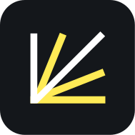

  

<h1 align="center">Livith · 라이빗</h1>

  <strong>모두가 라이브를 통해 빛나는 순간</strong>

  공연을 찾고, 셋리스트와 가사·응원법으로 나만의 관람을 준비해요.

  <a href="https://www.livith.site/">라이빗 바로가기</a>

## 라이빗 소개

라이빗은 공연을 발견하는 순간부터 무대에서 함께 노래하는 순간까지, 공연 관람에 필요한 정보를 모아 제공하는 서비스예요.
관심 있는 공연을 모아 일정을 살펴보고, 공연 정보와 셋리스트를 확인하며 관람을 준비할 수 있어요.

## 주요 기능

| 기능 | 할 수 있는 일 |
|------|---------------|
| 공연 탐색 | 공연을 검색하고, 취향에 맞는 추천 공연을 살펴봐요. |
| 공연 정보 | 일정·장소·아티스트·티켓·공연 문화·MD 정보를 확인해요. |
| 관심 공연·캘린더 | 관심 공연을 등록하고 캘린더에서 공연 일정을 살펴봐요. |
| 셋리스트·가사·응원법 | 셋리스트를 따라 곡을 확인하고, 제공되는 원어 가사·발음·해석·응원법으로 공연을 준비해요. |

## 이렇게 이용해요

1. **가고 싶은 공연을 찾아요.** 검색과 추천으로 관심 있는 공연을 발견해요.
2. **관심 공연으로 모아둬요.** 일정을 살펴보고 공연 정보와 셋리스트를 확인해요.
3. **함께 부를 노래를 준비해요.** 가사와 발음, 해석, 응원법을 보며 공연을 기다려요.

## 핵심 기술

## 기여자

<table>
  <tr>
    <td align="center">
      <a href="https://github.com/ah-o-ng12">
         
        이아영
      </a>
    </td>
    <td align="center">
      <a href="https://github.com/cjw020607">
         
        최지우
      </a>
    </td>
  </tr>
</table>
